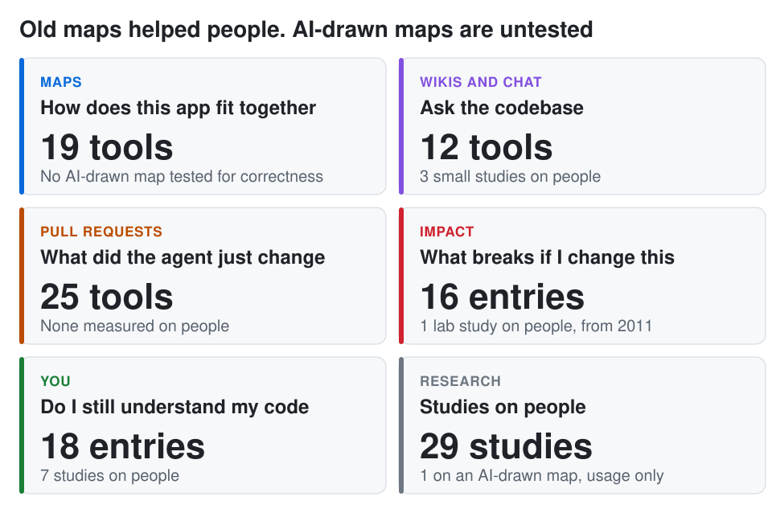

# Awesome Codebase Understanding 

> Understanding code you didn't write, and how much the tools for it are proven to help.

   

<picture>
  <source media="(prefers-color-scheme: dark)" srcset="assets/hero-dark.svg">
  
</picture>

An agent wrote half of the code, and now you have to answer "what happens when a user checks out?" or "is this pull request safe to merge?". This list is sorted by that question. Every entry says what its claim rests on, because most tools here publish no numbers on whether they help a person decide.

<!--lint disable table-pipe-alignment table-cell-padding-->

## Contents

- [Legend](#legend)
- [Start Here](#start-here)
- [What the Evidence Says](#what-the-evidence-says) - You want the numbers, not the tools.
- [How Does This App Fit Together](#how-does-this-app-fit-together) - You inherited a codebase and need the big picture.
- [Ask the Codebase](#ask-the-codebase) - You have a question and no one to ask.
- [What Did the Agent Just Change](#what-did-the-agent-just-change) - An agent opened a pull request.
- [What Breaks If I Change This](#what-breaks-if-i-change-this) - You are about to edit something shared.
- [Do I Still Understand My Code](#do-i-still-understand-my-code) - You merge code you could not explain.
- [Research on People](#research-on-people) - Every controlled study we could find, with its numbers.

## Legend

One mark per entry, from strongest to weakest: the strongest thing its claim to help rests on.

| Mark | Meaning |
| --- | --- |
| 🟢 | Measured. A published measurement with a method. The entry says on whom: people, agents or models. |
| 🟡 | Vendor claim. The maker says it helps and publishes no numbers. |
| ⚪ | Opinion. An argument, a worked example or an experience report. |
| no mark | The entry makes no claim to help. It only does something you can check yourself. |

Open source is noted in the text, not as a mark. Being able to read the code is not evidence that it helps you decide.

## Start Here

Four reads if you have one evening.

- ⚪ [Programming as Theory Building](https://pages.cs.wisc.edu/~remzi/Naur.pdf) - Peter Naur, 1985. A program is a theory held in its programmers' heads, not its source text; when the people who hold the theory leave, the program effectively dies. The origin of every cognitive debt argument here.
- ⚪ [Comprehension debt](https://addyosmani.com/blog/comprehension-debt/) - Addy Osmani. The gap between the code that exists and the code anyone on the team understands, and why review became a throughput problem.
- 🟢 [I ran 3 Claude Code architecture diagram tools on my repo](https://dev.to/yahhi/i-ran-3-claude-code-architecture-diagram-tools-on-my-repo-heres-what-each-one-got-right-110n) - 2026-11. Floorplan, Archify and Understand Anything on one real app, with three known-answer questions, times and costs. An agent reading the code with no map found a security hole all three maps missed. *Limits: one app, one author.*
- ⚪ [Four bets on understanding code your AI wrote](https://medium.com/@martin.jordanovski/archify-vs-graphify-vs-understand-anything-vs-codebase-memory-mcp-four-bets-on-understanding-code-88703e8ad3f5) - 2026-11. Sorts the big map tools by who reads the map, a person or the agent, and by who reads the code, a parser or the model.

<b>More reads (7)</b>

- ⚪ [Vibe code is legacy code](https://stevekrouse.com/syndicated/vibe-code) - Steve Krouse, 2025-07. Code nobody understands already has a name, legacy code; vibe coding is a spectrum of how much you understand, and fine for throwaway apps. Short, and the fastest way into Naur's idea. *Limits: opinion; the author sells an AI coding product.*
- ⚪ [The Final Bottleneck](https://lucumr.pocoo.org/2026/2/13/the-final-bottleneck/) - Armin Ronacher, 2026-02. Review is now the queue that overflows, as with 2,500 open pull requests on one project; since machines can't be accountable, humans have to understand the output, and throttling inflow is the only fix he sees today. *Limits: opinion, no data beyond the one pull request count.*
- ⚪ [Your job is to deliver code you have proven to work](https://simonwillison.net/2025/Dec/18/code-proven-to-work/) - Simon Willison, 2025-12. Moves the burden from the reviewer back to the author: attach a manual test with its commands and output, plus an automated test that fails if the change is reverted, and make the agent produce both. *Limits: opinion; proof of behaviour, not of design or of what the change touches outside the diff.*
- ⚪ [Getting AI to Work in Complex Codebases (No Vibes Allowed)](https://github.com/humanlayer/advanced-context-engineering-for-coding-agents/blob/main/ace-fca.md) - Dex Horthy, 2025. The written version of the "No Vibes Allowed" talk: review the agent's research and plan, not the 2,000-line diff, because a bad line of research becomes thousands of bad lines of code; review is for keeping the team's mental alignment. Includes a failed attempt. *Limits: experience report by a vendor of a tool for this workflow; numbers such as 35k lines in 7 hours are anecdotes, not a method.*
- ⚪ [Augmented Coding: Beyond the Vibes](https://newsletter.kentbeck.com/p/augmented-coding-beyond-the-vibes) - Kent Beck, 2025. In augmented coding you still care about the code and its tests; lists the signs an agent is going off track (loops, unrequested features, deleting tests) and gives his TDD system prompt. *Limits: one project, one author; more about steering than understanding someone else's change.*
- ⚪ [The Programmer's Brain](https://www.manning.com/books/the-programmers-brain) - Felienne Hermans, 2021, book. Cognitive science for reading unfamiliar code: working memory limits, misleading names, mental models, and onboarding that separates learning the domain from exploring the code. *Limits: draws on research but reports no new measurement; nothing on AI-written code.*
- ⚪ [Your Code as a Crime Scene, Second Edition](https://pragprog.com/titles/atcrime2/your-code-as-a-crime-scene-second-edition/) - Adam Tornhill, 2024, book. Reads a codebase through its Git history: hotspots where complexity meets change, change coupling, and knowledge maps of who still understands which part. The method behind several hotspot and ownership tools. *Limits: the author founded CodeScene, which sells this analysis; case studies, no controlled evaluation in the book page.*

## What the Evidence Says

**Maps have helped people, in old experiments.** A 3D code map made answers 24% more correct and 12% faster than an IDE with a metrics spreadsheet, with 41 participants, in 2011. A working-set code view made students 33% faster at fixing bugs, in 2010. One map built on a model was tried on 15 people, measuring how they used it, not whether they got answers right. None tested code written by an agent.

**AI help in review hasn't saved time.** Reviewers who started from an LLM review stuck to where it pointed, found no more serious issues and saved no time. At Meta, showing reviewers AI-suggested patches made reviews over 5% longer.

**Explanations raise confidence more than accuracy.** Programmers judged wrong LLM-generated assertions correctly only 49% of the time, and poor explanations lowered accuracy while raising confidence. In one small study, people using a codebase chatbot were more confused than people given a human-written tutorial, though total task time was the same.

**How a change is shown matters, a little.** Small changes are reviewed better. A defect in the last file of a review was 64% less likely to be found in one experiment. Reordering the parts of a change had no reliable effect.

**People misjudge their own speed.** Experienced developers took 19% longer with AI while believing it made them 20% faster.

**Scrutiny falls on its own.** As reviewers gained experience, approval of agent pull requests rose from 30.1% to 36.8% and inline comments fell by 22%.

## How Does This App Fit Together

Maps of a whole codebase: parts, files, requests and outside services. Older research maps were measured on people and helped; no map drawn by a model has been tested on people for correctness yet.

| Tool | Reads code | Shows a diff |
| --- | --- | --- |
| Floorplan | model | yes |
| Understand Anything | model | yes |
| Graphify | parser | ? |
| Archify | model | yes |
| CodeBoarding | both | ? |
| Repowise | parser | ? |

`?` means the project doesn't say. Both: a parser finds the links, a model names the parts.

**For people who don't read code.**

- 🟡 [Floorplan](https://github.com/haydenschmitty/floorplan) - Open source. A zoomable plain-English map of an app, from parts down to endpoints, with frontend requests matched to backend routes across repos. Highlights what the AI just changed and checks for keys in code and open endpoints. *Limits: no measurement of map accuracy; in one test its user flows were wrong in 2 places until re-traced.*
- 🟡 [Understand Anything](https://github.com/Egonex-AI/Understand-Anything) - Open source. A knowledge graph of files, functions and classes with plain-English summaries, a business-domain view, guided tours and diff impact. *Limits: no evaluation; the first analysis cost $13 on a 166-file app in one test.*
- 🟡 [Windsurf Codemaps](https://cognition.com/blog/codemaps) - You type a task or question and an agent draws a nested map of the code involved, as a list or a diagram, where each node jumps to the exact lines and a "trace guide" explains why they belong together. Maps can be shared as links and passed to the agent as context. *Limits: the launch post says they have yet to benchmark it even for agents, and nothing is measured on people; sharing stores the map on the vendor's servers.*
- 🟡 [CodeViz](https://www.codeviz.ai/) - Builds an editable C4 and UML architecture model of a codebase, with every box linked to source, and draws on-demand views of a workflow, API path or data flow. Models are versioned in Git and can be branched for proposed designs. *Limits: the site claims "10 hrs saved monthly" and "40x ROI" with no method behind either number.*

**For people who read code.**

- 🟡 [Graphify](https://github.com/Graphify-Labs/graphify) - Open source. A clickable graph of code, docs and PDFs, with a report of the most connected nodes. Code is parsed locally without a model, and each edge is marked extracted, inferred or ambiguous. *Limits: marks how sure it is per edge, but publishes no accuracy numbers.*
- 🟡 [Archify](https://github.com/tt-a1i/archify) - Open source. One validated interactive diagram of a slice of the system, in 10 types, with links back to the source and a before and after view for a change. *Limits: general diagramming, not codebase first; its "measured evidence" means diagram validation, not user outcomes.*
- 🟡 [CodeBoarding](https://github.com/CodeBoarding/CodeBoarding) - Open source. Interactive architecture diagrams: static analysis finds the relationships, a model names and describes the parts. *Limits: no published evaluation.*
- 🟡 [Sourcetrail](https://github.com/petermost/Sourcetrail) - Open source. An offline source explorer for C, C++ and Java that shows the graph of a symbol's callers, callees and members next to the code, kept buildable by a community fork after the original was archived in 2021. *Limits: says it helps you "get productive on unfamiliar source code" with no data; the maintainer wrote in 2026-08 that development will slow; binaries only for sponsors.*
- 🟡 [Code maps in Visual Studio](https://learn.microsoft.com/en-us/visualstudio/modeling/map-dependencies-across-your-solutions?view=visualstudio) - Generates a map of a .NET or C++ solution from assemblies down to methods, with calls, inheritance and field access as coloured links you expand, filter and drill into. *Limits: claims you see how code fits together "without reading through files" with no data; creating and editing maps needs Visual Studio Enterprise.*
- 🟡 [NDepend dependency graph and matrix](https://www.ndepend.com/features/dependency-graph-matrix-architecture) - A dependency graph and dependency structure matrix of a .NET codebase, with a query language over the code, layer violations, cycles and a compare-two-versions view. *Limits: calls its graph "the most powerful" in the industry with no comparison; its published eShopOnWeb numbers are about agents fixing issues, not about people reading the map.*
- [IntelliJ IDEA Dependency Structure Matrix](https://www.jetbrains.com/help/idea/dsm-analysis.html) - A matrix of dependencies between modules, packages and classes, sorted so a clean layering shows as a triangle and mutual dependencies show in red; click a cell to see the code that causes it.
- 🟡 [Emerge](https://github.com/glato/emerge) - Open source. Scans a codebase in 11 languages and produces an interactive web app of file and class dependency graphs, inheritance, fan-in and fan-out, Louvain modularity clusters and git-based change coupling. *Limits: aims at "a better understanding" of a codebase, with no evaluation.*

**Classic visualization.**

- 🟡 [CodeCharta](https://github.com/MaibornWolff/codecharta) - Open source. Turns a codebase into a 3D city where size, height and colour are metrics you pick, plus a map of its domain language and a dependency graph, with a live demo in the browser. *Limits: "find the hotspots in minutes" comes with no measurement; the code city idea was measured only on CodeCity in 2011.*
- [Gource](https://github.com/acaudwell/Gource) - Open source. An animation of a repository's history as a growing tree: directories are branches, files are leaves, and contributors fly in to touch the files they change.
- [Moose](https://github.com/moosetechnology/Moose) - Open source. A research platform for software analysis, started at the University of Bern in 1996: imports a codebase into a model you query, measure and visualize with your own views. Many published software visualization studies were built on it and its Roassal engine.

<b>More map tools (4)</b>

- 🟡 [GitDiagram](https://github.com/ahmedkhaleel2004/gitdiagram) - Open source. An interactive architecture diagram of any public GitHub repo and a one-minute explainer video. *Limits: no published evaluation.*
- 🟡 [codeflow](https://github.com/braedonsaunders/codeflow) - Open source. Paste a GitHub URL and get a map of how files connect and what breaks if you change one. *Limits: no published evaluation.*
- 🟡 [GitNexus](https://github.com/abhigyanpatwari/GitNexus) - Source available. A browser graph of symbols, calls and execution flows. *Limits: PolyForm Noncommercial licence.*
- 🟡 [Repowise](https://github.com/repowise-dev/repowise) - Open source. Architecture and C4 views, ownership, hotspots and dead code from a parsed graph. *Limits: its own comparison posts rank it first.*

## Ask the Codebase

Generated wikis and chat over a repository. Benchmarks grade them with models; the three small studies on people are under Research on People.

**Wikis.**

- 🟡 [DeepWiki](https://docs.devin.ai/work-with-devin/deepwiki) - A wiki per repo with diagrams, summaries, source links and questions you can ask. *Limits: its docs say large repos get partial coverage; maintainers report confident mistakes, such as work-in-progress code described as shipped.*
- 🟡 [Google Code Wiki](https://developers.googleblog.com/introducing-code-wiki-accelerating-your-code-understanding/) - A wiki per repo that regenerates as the code changes, with diagrams and chat. *Limits: claims like "understand new libraries in minutes" come with no data.*
- 🟢 [CodeWiki](https://github.com/FSoft-AI4Code/CodeWiki) - Open source. Repo documentation built from the dependency graph, one page per module, in 11 languages. Measured on documents: 68.79 against DeepWiki's 64.06 in the paper, 82.23 against 65.06 in a later re-run in the README. *Limits: graded by a model against a rubric; says nothing about whether a reader decides better.*
- 🟡 [Swimm](https://swimm.io/) - A map of a legacy system's flows, dependencies and business rules in plain English, each traced to lines of code and checked by domain experts, kept in sync with commits. *Limits: "95%+ accurate" and "100% coverage" are stated with no method; now sold mainly as a modernization service.*
- [deepwiki-open](https://github.com/AsyncFuncAI/deepwiki-open) - Open source. A self-hosted DeepWiki: wiki, diagrams and chat for your own repos.
- [OpenWiki](https://github.com/langchain-ai/openwiki) - Open source. A CLI that writes and maintains a Markdown wiki of the repo, written for agents first and readable by people.
- 🟡 [OpenDeepWiki](https://github.com/AIDotNet/OpenDeepWiki) - Open source. Turns a Git repo, ZIP or local folder into a published docs site with overviews, a wiki, mind maps and a chat assistant, updated incrementally. *Limits: no published evaluation; overlaps deepwiki-open, already listed.*
- 🟡 [Litho (deepwiki-rs)](https://github.com/sopaco/deepwiki-rs) - Open source. Generates architecture docs in the C4 model from source: context, container and component diagrams plus code-level pages, rerunnable in CI. *Limits: "perfectly in sync" and "save hundreds of hours" come with no data; the author now points to a successor aimed at agents.*

**Chat over a repo.**

- 🟡 [Sourcebot](https://docs.sourcebot.dev/docs/features/ask/overview) - Open source. Self-hosted code search with Ask Sourcebot: a model searches and follows code references across your repos and answers with inline citations, diagrams and clickable snippets, using a model provider you configure. *Limits: no published evaluation of answer accuracy.*
- 🟡 [Sourcegraph Deep Search](https://sourcegraph.com/docs/deep-search) - An agent that answers questions across many repositories with Sourcegraph search and code navigation, and lists every search it ran and file it read. *Limits: no accuracy numbers; enterprise plans only; its docs say shared answers do not enforce repository permissions.*
- 🟡 [GitHub Copilot Spaces](https://docs.github.com/en/copilot/concepts/context/spaces) - A shared collection of repos, files, pull requests, issues and notes that Copilot answers from, kept in sync with GitHub and shareable with a team for onboarding. *Limits: "an evergreen expert in your project" with no data.*
- 🟡 [Unblocked](https://getunblocked.com/) - Answers questions from code, Slack, issues and docs together, with source links and conflicting sources reconciled by recency and authority. *Limits: the helping claims are customer stories, such as a team taking over a platform in three months instead of six; the page reports a 107-task test on Claude Code without numbers, and the product now leads with agent context.*

**How accurate they are, measured on models.**

- 🟢 [SWD-Bench: Evaluating Repository-level Software Documentation via Question Answering](https://arxiv.org/abs/2604.06793) - 2026. Grades generated repository docs, DeepWiki among them, by whether a model can find and complete real functionality using them, mined from 4,170 pull request entries. The best method reached only 29.35 MCC on telling whether a feature is documented and 64.90 IoU on locating its files; human-written docs were competitive with the best generator; the best docs raised SWE-agent's issue-solving rate by 20.00%. *Limits: measured on models reading the docs, not on people.*
- 🟢 [SWE-QA: Can Language Models Answer Repository-level Code Questions?](https://arxiv.org/abs/2509.14635) - 2025. Open source. 576 question and answer pairs from 11 popular repositories, built from developer questions in 77,100 issues: intention, cross-file and multi-hop dependency questions. Agents that explore the repo beat retrieval, which beats answering directly. *Limits: measured on models; answers graded by a model judge, cross-checked by three engineers.*

## What Did the Agent Just Change

A pull request landed, mostly written by an agent, and you have to decide whether to merge it. None of these tools publishes a measurement on people. The experiments on how a change is shown are under Research on People.

**Read it in a sensible order.**

- 🟡 [Linear Diffs](https://linear.app/docs/diffs) - Shows a pull request next to its issue, core changes first with the reason for each section, tests and generated files hidden. *Limits: the risk score is a slot an outside provider fills; guides are on a paid tier.*
- 🟡 [CodeRabbit layer-based walkthroughs](https://www.coderabbit.ai/blog/explainable-prs-and-smarter-reviewer-routing) - Reorders the walkthrough into layers, from schema to backend to API to frontend to tests, with a summary per layer. *Limits: no numbers on review time or missed bugs.*
- 🟡 [Devin Review](https://docs.devin.ai/work-with-devin/devin-review) - An overview of the behaviour change, related edits grouped across files, move detection and a bug catcher. *Limits: no accuracy figures for the bug catcher.*
- 🟡 [Greptile PR summary](https://www.greptile.com/docs/code-review/first-pr-review) - A plain-language summary of what the pull request does and who it affects, a diagram picked by what changed (sequence, entity relation, class or flow) and a 0 to 5 merge confidence score. *Limits: the confidence score mixes bug count, complexity and pattern fit, with no accuracy figures.*
- 🟡 [Sourcery reviewer's guide](https://docs.sourcery.ai/Code-Review/Overview/) - Every review posts a summary of the change's purpose and risk, plus a reviewer's guide comment that maps the change file by file and says how to verify it. *Limits: the docs point to its own analytics on cycle time, no published numbers on understanding.*
- 🟡 [GitHub Copilot pull request summary](https://docs.github.com/en/copilot/how-tos/use-copilot-for-common-tasks/create-a-pr-summary) - Writes a summary of what changed into the pull request description or a comment. *Limits: the only study, listed under Research on People, measured an earlier version on early adopters and found faster reviews, not better ones.*
- 🟡 [PR-Agent](https://github.com/The-PR-Agent/pr-agent) - Open source. `/describe` writes a pull request description and file walkthrough, `/ask` answers free-text questions about the change. Donated by Qodo and now community-maintained. *Limits: no published evaluation of the descriptions; Qodo's hosted product is a separate thing.*
- 🟡 [Plannotator Code Tour](https://docs.plannotator.ai/open-source/workflows/agent-reviews) - Open source. A separate agent narrates the open diff with checkpoints, and saved guides are flagged when the code moves on. *Limits: its docs say the prompt doesn't enforce read-only and its findings are untrusted evidence.*
- 🟡 [What The Diff](https://whatthediff.ai/) - Writes a plain-English description of each pull request's diff, and short summaries for non-technical teammates by Slack or email. *Limits: support comes from user quotes only; reads the diff alone, not the rest of the codebase.*
- ⚪ [GitHub stacked pull requests](https://github.blog/engineering/turn-one-giant-ai-generated-pull-request-to-a-reviewable-stack/) - Splits one large agent pull request into single-purpose ones, read top down and reviewed bottom up. *Limits: a worked example, not a measurement.*

**Read the diff yourself.**

- [difftastic](https://github.com/Wilfred/difftastic) - Open source. A structural diff that compares syntax trees in 30+ languages, so reformatting and line splits don't show as changes. Works as Git's diff tool. *Limits: its README lists poor scaling on files with many changes and a side-by-side view that "can be confusing".*
- 🟡 [SemanticDiff](https://semanticdiff.com/) - A language-aware diff for VS Code and GitHub pull requests that hides formatting-only changes and highlights moved code and renames. *Limits: "understand code changes faster" comes with no data; closed source.*
- [Reviewable](https://docs.reviewable.io/files) - A review UI on GitHub pull requests that records which revision of each file each reviewer has seen, so the next diff shows only what is new to you. Survives rebases and auto-groups renamed, vendored and reverted files.
- [hunk](https://github.com/modem-dev/hunk) - Open source. A terminal diff viewer built for reviewing agent-written changes.
- [tuicr](https://github.com/agavra/tuicr) - Open source. A terminal code reviewer that tracks which hunks you have actually seen.
- [ReviewStack](https://sapling-scm.com/docs/addons/reviewstack/) - Open source. Swap github.com for reviewstack.dev in a pull request URL to review a stack one commit at a time, with a dropdown to move through the stack. *Limits: its docs say it is less complete than GitHub's own UI, especially for large pull requests.*
- [ghstack](https://github.com/ezyang/ghstack) - Open source. Submits each commit of a local stack as its own GitHub pull request. With `automsg` set, Claude or Codex writes the update note from the interdiff against what was last submitted, so a reviewer sees what changed since the last look.
- [diffsitter](https://github.com/afnanenayet/diffsitter) - Open source. A tree-sitter diff that ignores formatting and can filter which kinds of syntax nodes count. *Limits: its README says it is "nowhere close to production ready".*

**Check what the agent says it did.**

- 🟡 [Git AI](https://github.com/git-ai-project/git-ai) - Open source. Agents report the lines they wrote, and a Git extension stores them in Git notes, so `git ai blame` shows which lines came from which agent, model and prompt. Attribution survives rebase, squash and cherry-pick. *Limits: "never lose the intent" is a claim; renames are not tracked and the prompt store is in the paid tier.*
- 🟡 [Entire CLI](https://github.com/entireio/cli) - Open source. Saves each agent session (prompts, transcript, files touched) as a checkpoint linked to the commit, which `entire checkpoint explain` shows. Its Trails page shows a change with scores from review agents in place of the raw diff. *Limits: Trails need Entire hosting; transcripts are pushed to the remote, public if the repo is.*
- [Copilot cloud agent session logs](https://docs.github.com/en/copilot/how-tos/use-copilot-agents/cloud-agent/track-copilot-sessions) - Each commit from Copilot's cloud agent links to its session log: the reasoning, tools used, and tests and linters it ran. *Limits: only for Copilot's own agent; the log is the agent's account of itself.*
- 🟡 [SpecStory](https://github.com/specstoryai/getspecstory) - Open source CLI. Saves sessions from Claude Code, Codex, Cursor and others as Markdown under `.specstory/history/`, so the conversation behind a change can be read next to it. *Limits: not linked to specific lines or commits; the IDE extensions are closed source.*
- ⚪ [Showboat](https://github.com/simonw/showboat) - Open source. The agent writes a demo document of the commands it ran and their output, and `verify` re-runs them. *Limits: its author notes agents edit the document instead of running commands.*
- [Agent Trace](https://agent-trace.dev) - An open spec for recording which lines came from which model and conversation. *Limits: a data format, not a view; quality assessment is an explicit non-goal.*
- 🟡 [accountable-review](https://github.com/wyeworks/accountable-review) - Open source. A Claude Code plugin that turns a pull request into a published HTML review map. *Limits: young project, no evaluation.*

## What Breaks If I Change This

The impact of a change before you make it. One lab study, from 2011, measured an interactive call graph on people.

**Before you edit.**

- 🟡 [Sourcegraph code navigation](https://sourcegraph.com/docs/code-search/code-navigation) - Go to definition, find references and find implementations across repositories in the browser, either search-based or precise from compiler indexes (SCIP). *Limits: its docs say it helps in "determining the impact of code changes"; no numbers.*
- 🟡 [Understand by SciTools](https://docs.scitools.com/help/graphs/open-a-graph.html) - Interactive graphs of what a function calls and what calls it, including a butterfly view that shows both directions around one function or one architecture part, plus a compare variant across versions. *Limits: vendor docs only, no published evaluation.*
- 🟡 [code-review-graph](https://github.com/tirth8205/code-review-graph) - Open source. The blast radius, affected tests and risk-scored review context for a change. *Limits: built as context for AI tools first.*
- 🟡 [codebase-memory-mcp](https://github.com/DeusData/codebase-memory-mcp) - Open source. The symbols a diff touches, with risk, and a browser view in beta. *Limits: agent-first.*
- 🟢 [CodeGraph](https://github.com/colbymchenry/codegraph) - Open source. A symbol and call graph with blast-radius queries. Measured on agents: 53% faster and 88% fewer tool calls on its authors' runs. *Limits: about 80% more retrieved context left in the window; nothing about a person's decision.*
- [sem](https://github.com/Ataraxy-Labs/sem) - Open source. Diffs, blame and impact at the level of functions and classes instead of lines, on top of Git.
- [Nx affected and graph](https://nx.dev/docs/features/ci-features/affected) - Open source. `nx affected --graph` shows which projects and tasks a branch's changed files reach, and `--explain` prints why each task is affected, file by file. *Limits: works on the declared project and task graph of an Nx monorepo, not on calls inside a project.*
- [Madge](https://github.com/pahen/madge) - Open source. Draws a graph of JavaScript and CSS preprocessor module dependencies and finds circular dependencies, so you can see what imports a file before you change it. *Limits: module imports only, no calls or runtime paths.*

**From the history.**

- 🟡 [CodeScene hotspot maps](https://codescene.io/docs/guides/technical/hotspots.html) - A zoomable circle map of the codebase coloured by change frequency, code health, defects and cost, filterable by team or author, with change-coupling lines between files that change together. Built from Git history plus static analysis. *Limits: its "45% of bugs in 1.2% of the code" is an example dashboard, not a study; nothing measures whether the map changes a decision.*
- [Code Maat](https://github.com/adamtornhill/code-maat) - Open source. A command line tool that mines Git history for change frequency, change coupling, ownership and churn per file, the analyses behind "Your Code as a Crime Scene". *Limits: CSV output, no view of its own; its README says the analyses moved into CodeScene.*
- 🟡 [Git Truck](https://github.com/git-truck/git-truck) - Open source. A local, offline view of a repository's structure coloured by commit activity and authorship, so you see who worked where and when, and how it changed over time. *Limits: says it helps you "quickly" answer such questions, with no data.*
- 🟢 [Mining Version Histories to Guide Software Changes (ROSE)](https://ieeexplore.ieee.org/document/1463228) - 2005. "Programmers who changed these functions also changed": rules mined from commits suggest what else a change must touch. On the history of eight open source projects, the top three suggestions held a correct location more than 70% of the time. *Limits: measured on replayed history, not on people using it.*
- 🟢 [Supporting Change Impact Analysis Using a Recommendation System (ImpRec)](https://mrksbrg.com/tse16_borg/) - 2017. A tool that recommends artifacts likely touched by a fix, mined from 12 years of past impact reports at a safety-critical company. It put about 40% of the true impact in its top 10 recommendations, and in deployment with two teams developers said it helped, newcomers most. *Limits: correctness measured by simulation; the human side is logs and interviews, not a controlled test; one company.*

**Rules that stop it.**

- [dependency-cruiser](https://github.com/sverweij/dependency-cruiser) - Open source. Draws the module dependency graph of a JavaScript or TypeScript project and checks it against rules you write, such as no cycles or no imports from one layer into another, in text for CI and in graphs.
- [ArchUnit](https://github.com/TNG/ArchUnit) - Open source. Architecture rules as Java or Kotlin unit tests: allowed dependencies between packages, layers and slices, and no cycles, so a forbidden edge fails the build with the offending classes named. *Limits: only checks the rules someone wrote.*
- [Tach](https://github.com/tach-org/tach) - Open source. Declares Python modules and their allowed dependencies and public interfaces, and fails on imports outside them and on cycles. *Limits: Python only; the repo moved from gauge-sh to tach-org.*

## Do I Still Understand My Code

Keeping your own understanding while an agent writes the code.

**Tools.**

- [rederive](https://github.com/EricJujianZou/rederive) - Open source. A Claude Code skill that asks how you would explain code the AI wrote for you, before someone else asks.
- [understanding-map](https://github.com/amit429/understanding-map) - Open source. A Claude Code plugin that finds the code nobody on the team understands any more.
- [mindwalk](https://github.com/cosmtrek/mindwalk) - Open source. Replays a coding-agent session on a 3D map of the codebase, so you can see where it went.
- 🟡 [grokcheck](https://github.com/Tsadoq/grokcheck) - Open source. A Claude Code plugin that turns a change or an area of code into a browser lesson with locked checkpoint questions (predict the output, pick the buggy line, mutation quiz, fix a planted bug) and a closed-book final quiz that shows where your confidence was wrong. Missed questions come back after 1, 3, 7, 21 and 60 days. *Limits: no measurement that the quiz score tracks real understanding or that it changes later decisions.*
- 🟡 [codecall](https://github.com/GAURAV-1313/codecall) - Open source. A skill for Claude Code, Codex, Cursor and others: after the agent changes something, a short session on the 2 to 4 ideas behind it with two checks per idea and a receipt marking each idea "could explain" or "could not". Also traces one request file by file and runs debugging drills with a planted bug. *Limits: no evaluation; the receipt is self-graded by the same agent that wrote the code.*
- [Claude Code Explanatory and Learning output styles](https://code.claude.com/docs/en/output-styles) - Built-in modes. Explanatory adds short "Insight" blocks on why the code was written that way; Learning also leaves `TODO(human)` spots at real design decisions for you to write yourself. *Limits: the docs say a style is an instruction, not a guarantee; nothing is measured.*
- ⚪ [Interactive explanations](https://simonwillison.net/guides/agentic-engineering-patterns/interactive-explanations/) - Simon Willison. A worked pattern for paying down cognitive debt: ask the agent for a linear walkthrough, then for an animated explanation of the part that still does not click. *Limits: one worked example by one author.*

**What is measured.**

- 🟢 [Measuring the Impact of Early-2025 AI on Experienced Open-Source Developer Productivity](https://arxiv.org/abs/2507.09089) - 2025. Measured on people: randomized trial, 16 experienced developers, 246 tasks in their own mature repos. With AI allowed tasks took 19% longer, while the same developers believed AI had made them 20% faster. *Limits: measures time, not understanding; METR's 2026 follow-up ([update](https://metr.org/blog/2026-02-24-uplift-update/)) says selection effects now make its newer estimates unreliable and speedup is likely higher with current tools.*
- 🟢 [How AI Impacts Skill Formation](https://arxiv.org/abs/2601.20245) - 2026. Measured on people: in a randomized trial with 52 engineers, those using AI took the same time but scored 17% lower on a comprehension quiz, 50% against 67%. *Limits: about learning with AI, not about maps.*
- 🟢 [Feeling Easier, Working Harder: Cognitive Load in AI-Assisted Code Comprehension](https://arxiv.org/abs/2611.12019) - 2026. Measured on people: 20 novice CS students read Java with and without AI, then took a quiz without AI. AI raised measured cognitive load (reaction times up 11.2%) while perceived load stayed the same, and there was no evidence that comprehension improved; some read the AI's explanation instead of the code. *Limits: 20 students, a ceiling effect on the quiz; accepted to ICSE 2027.*
- 🟢 [The Widening Gap: The Benefits and Harms of Generative AI for Novice Programmers](https://arxiv.org/abs/2405.17739) - 2024. Measured on people: 21 lab sessions with eye tracking and interviews. 20 of 21 students finished, but those who struggled had their metacognitive problems compounded by AI, thought they did better than they did and ended with an illusion of competence. *Limits: qualitative, one problem, students.*
- 🟢 [Comprehension Debt in GenAI-Assisted Software Engineering Projects](https://arxiv.org/abs/2604.13277) - 2026. Measured on people (qualitative): 621 reflective diaries from 207 students over eight weeks. Four patterns that build comprehension debt (black-box acceptance, context mismatch, dependency-induced atrophy, skipped verification) and one that reduces it: using AI as a comprehension scaffold. *Limits: student diaries, no effect sizes, 5-page paper.*
- 🟢 [Your Brain on ChatGPT: Accumulation of Cognitive Debt when Using an AI Assistant for Essay Writing Task](https://arxiv.org/abs/2506.08872) - 2025. Measured on people: 54 participants wrote essays with an LLM, a search engine or no tool, under EEG. LLM users showed the weakest brain connectivity, the lowest sense of owning their essays and struggled to quote their own work; when switched to no tool in session 4 (18 people) they stayed under-engaged. *Limits: essays, not code; small session 4; a later comment paper (arXiv 2601.00856) critiques it.*
- 🟢 [The Impact of Generative AI on Critical Thinking](https://www.microsoft.com/en-us/research/publication/the-impact-of-generative-ai-on-critical-thinking-self-reported-reductions-in-cognitive-effort-and-confidence-effects-from-a-survey-of-knowledge-workers/) - 2025. Measured on people (survey): 319 knowledge workers, 936 examples. Higher confidence in the AI went with less critical thinking, higher self-confidence with more. *Limits: self-report, not coding-specific.*

**Essays.**

- ⚪ [Comprehension Debt: The Ticking Time Bomb of LLM-Generated Code](https://codemanship.wordpress.com/2025/09/30/comprehension-debt-the-ticking-time-bomb-of-llm-generated-code/) - Jason Gorman, 2025-09. Coins "comprehension debt": the extra time it will take to understand generated code before you can change it, growing as teams ship code nobody has read. *Limits: short opinion post; the "70% of the time" figure has no source.*
- ⚪ [How Generative and Agentic AI Shift Concern from Technical Debt to Cognitive Debt](https://margaretstorey.com/blog/2026/02/09/cognitive-debt/) - Margaret-Anne Storey, 2026-02. Cognitive debt lives in people, not code; a student team that could no longer change its own app by week 7 or 8; practices such as one human fully understanding each AI change before it ships. Follow-up: [What I'm hearing about cognitive debt](https://margaretstorey.com/blog/2026/02/18/cognitive-debt-revisited/). *Limits: one classroom anecdote.*
- ⚪ [From Technical Debt to Cognitive and Intent Debt](https://arxiv.org/abs/2603.22106) - Margaret-Anne Storey, 2026. A Triple Debt Model: technical debt in code, cognitive debt in people, intent debt in missing written rationale, with how to diagnose and reduce each. *Limits: a position paper, no data.*
- ⚪ [Cognitive Debt in the GenAI Era](https://arxiv.org/abs/2610.37888) - 2026. A review of 76 practitioner sources on lost understanding, with suggested practices such as design rationale notes and review-sized changes. *Limits: no effect sizes.*

## Research on People

Controlled experiments, field studies and surveys of people reading, reviewing or explaining code. Each says who took part and what was measured.

**Maps and visualization.**

- 🟢 [Software Systems as Cities: A Controlled Experiment](https://wettel.github.io/download/Wettel11a-icse.pdf) - 2011. Measured on people: 41 participants (20 industry practitioners) answered program comprehension questions about real Java systems; CodeCity, a 3D city map of the code, gave +24% correctness and -12% completion time against Eclipse plus Excel, statistically significant. *Limits: built and tested by the tool's authors; metric and structure questions on human-written code, not change review; on focused tasks needing precise answers CodeCity did no better.*
- 🟢 [Code Bubbles: A Working Set-based Interface for Code Understanding and Maintenance](https://cs.brown.edu/people/spr/codebubbles/CHI-final.pdf) - 2010. Measured on people: 20 students fixed two bugs in a 2,658-line Java app; with Code Bubbles they were 33.2% faster over both tasks, finished significantly more tasks and spent 3.5 instead of 11.6 minutes navigating, against Eclipse. *Limits: students, one small app, task 2 alone not significant; a working-set view, not a whole-codebase map.*
- 🟢 [Visualizing call graphs (REACHER)](https://www.computer.org/csdl/proceedings-article/vlhcc/2011/06070388/12OmNxjjEdP) - 2011. Measured on people: in a lab study with 12 participants answering control flow questions, those using the REACHER interactive call graph were 5.6 times more successful than with a standard IDE (78% against 14%), and faster on 4 of 6 tasks. *Limits: 12 participants, lab tasks, a research prototype; it measures answering "what calls what", not deciding whether a change is safe.*
- 🟢 [LACY: Simulating Expert Mentoring for Software Onboarding with Code Tours](https://arxiv.org/abs/2603.25391) - 2026. Measured on people: within-subjects study at one company on a 30K+ line legacy system; with expert-curated, AI-assisted code tours, 5 learners scored 83% on quizzes against 57% with AI-only tours and finished in about 25 instead of 35 minutes. Learners did not perceive the difference (3.4 of 5). *Limits: 5 learners, 2 experts, one system; no baseline without tours; built by the authors with the company.*
- 🟢 [Understanding Codebase like a Professional! Human-AI Collaboration for Code Comprehension](https://arxiv.org/abs/2504.04553) - 2025. Measured on people: CodeMap, an LLM-backed interactive code map, tested with 9 experienced and 6 novice developers; it cut reliance on reading LLM responses by 79% and raised map usage time by 90% against a static visualization tool, and improved perceived understanding. *Limits: 15 people; reports perceived understanding and usage, not correctness of answers or decisions.*
- 🟢 [A Systematic Literature Review of Software Visualization Evaluation](http://scg.unibe.ch/archive/papers/Meri18a.pdf) - 2018. Of 181 SOFTVIS/VISSOFT papers with an extractable evaluation, 62% of the proposed visualizations had no evaluation or only a weak one. *Limits: covers papers up to 2017; counts evaluation quality, not effect sizes.*

**Chat and AI explanations.**

- 🟢 [Questions Before Answers? A Comparison of Codebase Chatbots and Tutorials for Codebase Learning](https://doi.org/10.1184/R1/29086835) - 2025. Measured on people: a between-subjects experiment with 15 experienced programmers (one dropped out) on an unfamiliar Django app, Sourcegraph Cody against a human-written tutorial. The tutorial group took significantly less time to get started (p about 0.0034); chatbot users were more confused and less confident, tutorial users understood the structure better but lacked low-level details. *Limits: the time to get started was counted after the tutorial, which took 27 minutes on average, and total task time showed no difference; 14 people, one app, Cody 0.6.7; one author works at a company that makes onboarding tutorials.*
- 🟢 [Using an LLM to Help With Code Understanding](https://arxiv.org/abs/2307.08177) - 2024 (ICSE). Measured on people: 32 participants with an in-IDE chat plugin (GILT) against web search. Plugin users completed significantly more sub-tasks (0.47 more), with no significant difference in completion time or code understanding quiz scores; the gain was significant only for professionals, not students. *Limits: explains highlighted code and APIs, not a whole repository; GPT-3.5.*
- 🟢 [Programmers Are Poor and Overconfident Judges of LLM-Generated Assertions](https://arxiv.org/abs/2607.08885) - 2026. Measured on people: a controlled experiment with 86 Python programmers. They judged correct generated assertions right 74% of the time and incorrect ones 49%, with the same confidence; natural-language explanations gave no overall benefit, and poor explanations lowered accuracy while raising confidence. *Limits: assertions on small functions, not whole changes.*
- 🟢 [A Human Study of Comprehension and Code Summarization](https://dijkstra.eecs.umich.edu/kleach/icpc2020-code-summarization.pdf) - 2020. Measured on people: 45 students and professionals answered comprehension questions on Java methods with summaries; they did significantly better with human-written than machine-generated summaries (p = 0.029), yet did not perceive the two as different, and their performance did not correlate with BLEU or ROUGE. *Limits: pre-LLM neural summarizers.*
- 🟢 [An LLM Assistant for Software Project Onboarding](https://doi.org/10.1145/3696630.3728719) - 2025. A RAG chatbot (SPAC-B) answering project questions on two open-source projects scored a mean 4.6 of 5 for relevance and 4.3 for completeness and correctness; in an experiment with 10 developers, participants made better implementation plans with it and 8 of 10 found it helpful. *Limits: 10 people, the authors' own tool, answers rated on a Likert scale rather than checked against the code.*

**Reviewing AI-written changes.**

- 🟢 [Deep Learning-based Code Reviews: A Paradigm Shift or a Double-Edged Sword?](https://arxiv.org/abs/2411.11401) - 2025. Measured on people: 29 professional developers, over 50 hours of recorded reviews, with or without an LLM-generated review as a starting point. Reviewers focused on the locations the LLM pointed at, found more low-severity issues but not more high-severity ones, saved no time and were not more confident. *Limits: seeded issues in small programs.*
- 🟢 [AI-Assisted Fixes to Code Review Comments at Scale](https://arxiv.org/abs/2507.13499) - 2026. Measured on people at Meta: in a randomized controlled safety trial, showing reviewers AI-suggested patches made reviews take over 5% longer, because reviewers checked the AI patches; showing the suggestions only to authors removed the regression. *Limits: measures review time, not defects caught.*
- 🟢 [The Effect of Complexity and Provenance on Code Review Decisions](https://www.zora.uzh.ch/server/api/core/bitstreams/a54a1002-e14e-47f4-b957-2279662becde/content) - 2026. Measured on people: between-subjects experiment with 385 participants deciding to accept or reject a suggested code revision. Higher code complexity significantly increased acceptance of incorrect suggestions (p < .05); labelling the suggestion as AI or human had no statistically supported effect, and no supported interaction with complexity. *Limits: one changeset, one suggestion per person.*
- 🟢 [Same Scrutiny, More Time: Eye Tracking Insights into Reviewing LLM-Labelled Code](https://arxiv.org/abs/2606.26505) - 2026. Measured on people with eye tracking: Wizard-of-Oz experiment with 32 software engineers; code labelled as LLM-generated got longer total fixation (95% CI 0.09 to 0.56, up to 15 extra seconds on longer segments) but no change in how thoroughly it was read. *Limits: attention, not defects found.*
- 🟢 [A Study on Developer Behaviors for Validating and Repairing LLM-Generated Code Using Eye Tracking and IDE Actions](https://arxiv.org/abs/2405.16081) - 2024. Measured on people: 28 participants validated and repaired Copilot-generated code in three projects. Without being told, they often did not notice the code came from an LLM; the group told the provenance fixed more bugs (success rate 0.577 vs 0.446, p = 0.042), searched more and reported higher workload. *Limits: 28 people; Singh et al. 2026 found no label effect on accept or reject decisions.*
- 🟢 [Habituation at the Gate](https://arxiv.org/abs/2606.22721) - 2026. Across 11,429 reviews by 400 repeat reviewers, approval of agent pull requests rose from 30.1% to 36.8%, inline comments fell 22% and change requests halved. *Limits: can't separate habituation from agents getting better.*
- 🟢 [Analyzing Message-Code Inconsistency in AI Coding Agent-Authored Pull Requests](https://arxiv.org/abs/2601.04886) - 2026. 1.7% of 23,247 agent pull requests had descriptions that didn't match the code. Those were accepted 28.3% of the time against 80.0% and took 3.5 times longer to merge. *Limits: shows a wrong summary costs time, not that a good one saves it.*
- 🟢 [Generative AI for Pull Request Descriptions](https://dl.acm.org/doi/10.1145/3643773) - 2024. Pull requests with Copilot-written descriptions were reviewed 19.3 hours faster and were 1.57 times likelier to merge. *Limits: early adopters; merging is not correctness.*
- 🟢 [How AI Coding Agents Communicate](https://arxiv.org/abs/2602.17084) - 2026. More structured agent pull request descriptions went with faster responses and completion. *Limits: the authors say simpler changes may explain it.*
- 🟢 [AI Writes Faster Than Humans Can Review](https://arxiv.org/abs/2607.01904) - 2026. Measured on people, observational: 802 developers and 196,212 pull requests at one company under a "2x" mandate. Throughput rose about 12% when each developer started using AI and kept rising; review load per reviewer doubled and automated review passed human review in coverage within months. *Limits: one company, no randomized assignment; pull request count is a proxy for productivity, not for understanding.*
- 🟢 [Trust-Calibrated Code Review](https://arxiv.org/abs/2606.01969) - 2026. A three-level review flow from overview to file to snippet; 63% of 43 surveyed developers expected less review effort. *Limits: expectations of a prototype, not measured use.*
- 🟢 [Human oversight of agentic systems in practice](https://arxiv.org/abs/2606.05391) - 2026. Interviews with 17 practitioners describe four ways people oversee agents, from up-front control to review after the fact. *Limits: qualitative, no outcome numbers.*

**How a change is shown.**

- 🟢 [Associating Working Memory Capacity and Code Change Ordering with Code Review Performance](https://sback.it/publications/emse2019a.pdf) - 2019. A controlled experiment with 50 participants, mostly professional developers, reviewing changes with seeded defects. Reviews of small changes found significantly more defects; the order in which change parts were shown showed only a tendency to affect efficiency that the authors "cannot conclude reliably". *Limits: pre-AI code, one open source system; tests ordering theory, not a shipping tool.*
- 🟢 [First Come First Served: The Impact of File Position on Code Review](https://arxiv.org/abs/2208.04259) - 2022. Measured on people: online controlled experiment with 106 participants; for one of two seeded defects, odds of finding it were 64% lower when its file came last rather than first. Supports tools that reorder a diff. *Limits: human-written code; one defect type showed no effect.*
- 🟢 [The effects of change decomposition on code review: a controlled experiment](https://pmc.ncbi.nlm.nih.gov/articles/PMC7924728/) - 2019. Measured on people: 28 professionals and graduate students reviewed one tangled pull request or the same change split in two; splitting reduced wrongly reported issues but changed neither defects found nor understanding of the change rationale. *Limits: relevant to stacked agent pull requests, but human-written code.*
- 🟢 [Helping Developers Help Themselves: Automatic Decomposition of Code Review Changesets](https://www.microsoft.com/en-us/research/publication/helping-developers-help-themselves-automatic-decomposition-of-code-review-changesets/) - 2015. ClusterChanges splits one changeset into independent parts. On 1,000 Microsoft review changesets, about 42% had more than one non-trivial part; in interviews 16 of 20 developers said the split for their own change was correct and complete. *Limits: authors judged their own changes in a qualitative study; no measure of review speed or missed bugs.*
- 🟢 [Less is More: Supporting Developers in Vulnerability Detection during Code Review](https://arxiv.org/abs/2202.04586) - 2022 (ICSE). Measured on people: an online experiment with 150 participants. Simply asking reviewers to focus on security raised the probability of finding the vulnerability eight times; a security checklist, even one tailored to the change, did not improve it further. *Limits: human-written code and seeded vulnerabilities; says nothing about AI-written changes or tools.*
- 🟢 [How Do Software Engineers Understand Code Changes? An Exploratory Study in Industry](https://yidatao.github.io/paper/tao_fse12.pdf) - 2012. A survey of 180 Microsoft engineers plus follow-up interviews: the rationale of a change was the most important need, and its risk ("does this change break any code elsewhere?") was very important and among the hardest to get. They asked for a diff with "find caller" and a view of impacted code and affected tests. *Limits: survey and interviews, 16% response rate, one company, before AI-written code.*

---

**How entries get in.** A tool helps a person understand a codebase or a change, links to its primary source, and gets the strongest mark its own evidence supports. A study measures how people understand or review code. Every entry names what its evidence doesn't cover.

**What this list doesn't do.** It doesn't test the tools. A mark says what the maker or the authors have shown, not that the tool works on your code.

**Related lists.** [awesome-code-review](https://github.com/joho/awesome-code-review) for code review in general, [awesome-code-review-research](https://github.com/mgreiler/awesome-code-review-research) for academic work on code review, [awesome-claude-code](https://github.com/jqueryscript/awesome-claude-code) for Claude Code plugins, [Awesome Agents in Production](https://github.com/redikultsev/awesome-agents-in-production) for what breaks when agents run in production.

Contributions welcome: read the [contribution guidelines](contributing.md) first. Licensed [CC BY 4.0](LICENSE).
